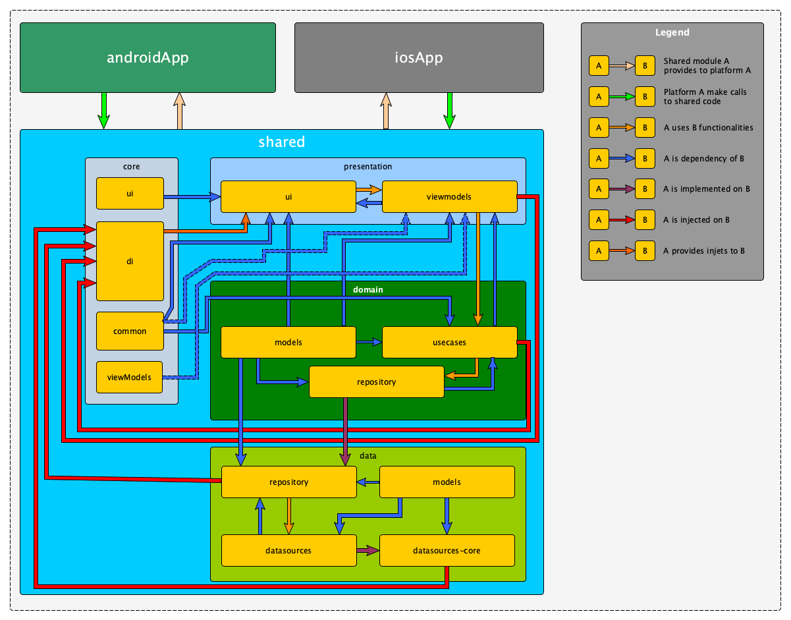
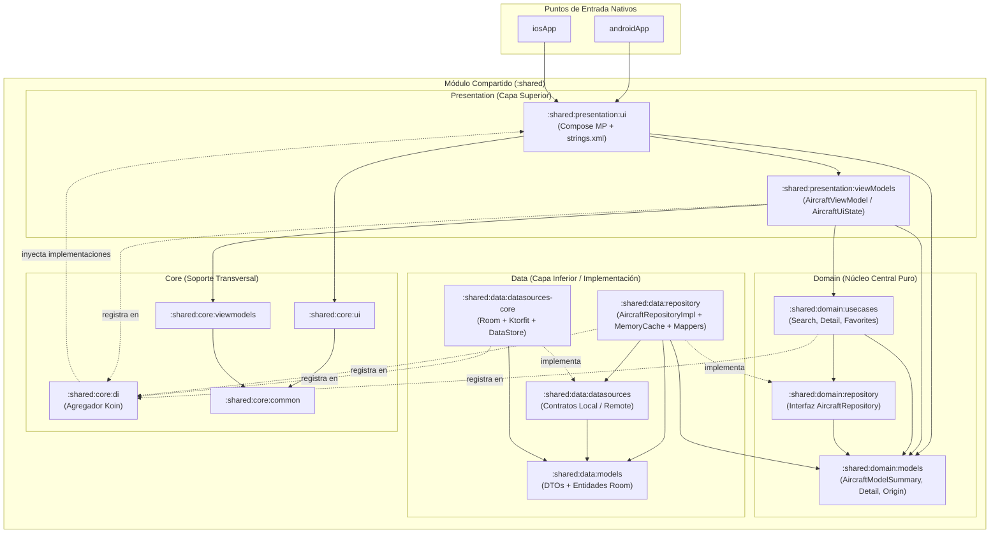
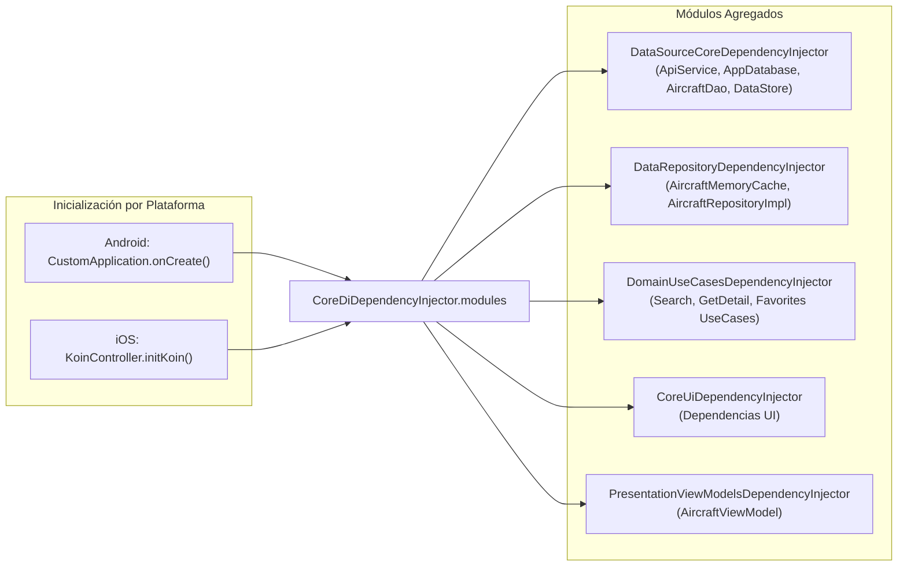
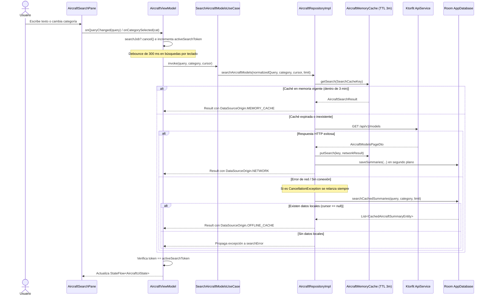
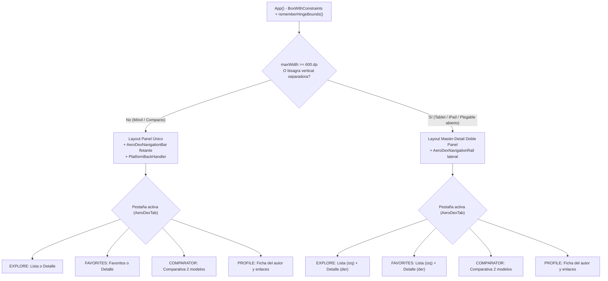
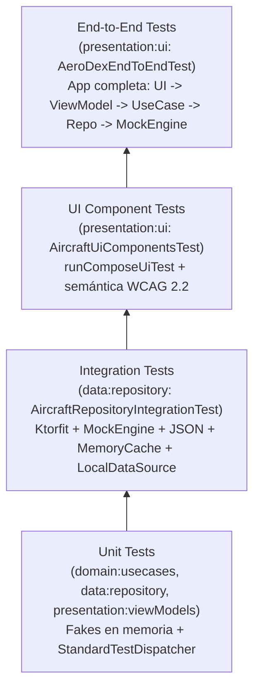

# AeroDex — Documentación Técnica y Guía de Arquitectura

> **Guía de referencia para revisores técnicos.** Este documento describe la arquitectura, el stack tecnológico, los flujos de datos y concurrencia, los casos de uso, la estrategia de testing y los flujos de desarrollo de **AeroDex** (`dev.afalabarce.aircrafts`).

---

## 1. Visión General del Proyecto

**AeroDex** es una aplicación móvil **Kotlin Multiplatform (KMP)** para **Android e iOS** con interfaz compartida en **Compose Multiplatform**, orientada a la exploración, consulta técnica, gestión de favoritos offline y comparación lado a lado de aeronaves comerciales y militares a partir de la API pública **Flight API - Aircraft Database** (`https://flightapi.afalabarce.dev/`).

### Objetivos de Ingeniería
- **Base de código única (Android + iOS):** lógica de negocio, acceso a datos, persistencia local, estado de presentación e interfaz Compose compartidos en `:shared`.
- **Clean Architecture estricta:** separación física en módulos Gradle independientes con regla de dependencia unidireccional hacia `:shared:domain`.
- **Offline-First y Resiliencia:** caché en memoria con TTL de 3 minutos (`AircraftMemoryCache`) + persistencia local en **Room Multiplatform** (`AppDatabase`) con fallback automático ante fallos de red.
- **UI Adaptativa y Expresiva:** diseño **Material 3 Expressive** adaptable dinámicamente a teléfonos, tablets, iPads y dispositivos plegables (`BoxWithConstraints` + `HingeBounds`), cumpliendo **WCAG 2.2 Nivel AA+**.
- **Calidad y Verificabilidad:** análisis estático con **Detekt + Compose Rules** y pirámide completa de pruebas (Unitarias, Integración, UI Compose y End-to-End) sin librerías de *mocking* reflexivas.

### 1.1 Decisión Tecnológica: Kotlin Multiplatform

Se adopta **Kotlin Multiplatform (KMP)** para compartir las capas de dominio, datos y presentación entre Android e iOS, conservando las integraciones nativas de cada plataforma. La decisión responde a un criterio funcional —mantener una única implementación de reglas de negocio, persistencia y flujos de presentación— y a uno tecnológico: el código de `:shared` se escribe en Kotlin, se compila para el destino Android y se consume directamente desde `:androidApp`. Por tanto, las funcionalidades incluidas en las capas compartidas son **100 % compatibles con su uso en Android**, sin traducción de código, reescrituras ni adaptadores adicionales para la aplicación Android.

Para el desarrollo Android previsto por esta arquitectura, la curva de aprendizaje es **nula**: se conservan Kotlin, Android Studio, Gradle, las APIs Android y el flujo habitual de compilación, ejecución, depuración y pruebas. KMP no introduce una forma distinta de implementar la funcionalidad Android; permite ampliar gradualmente el mismo código al destino iOS. Las diferencias de plataforma quedan confinadas a los puntos de integración y a las implementaciones específicas (`androidMain`/`iosMain`), por lo que no interrumpen ni modifican el flujo Android. La curva de desarrollo es lineal respecto al alcance: cada funcionalidad compartible se implementa una vez y el esfuerzo adicional se limita a las integraciones específicas que requiera cada plataforma. El aprendizaje de APIs nativas de iOS solo es necesario para tareas exclusivas de iOS, no para desarrollar o mantener la aplicación Android.

---

## 2. Arquitectura Modular (Clean Architecture KMP)

La solución aplica **Clean Architecture estricta** dentro de `:shared` con **`:shared:domain` en el centro absoluto** de la arquitectura. Tanto la capa de presentación (`:shared:presentation`) como la capa de datos (`:shared:data`) apuntan hacia `:shared:domain`, sin que exista ninguna dependencia directa entre `presentation:viewModels` y `data`.



### 2.1 Posición Central del Dominio y Dependencias entre Módulos

El siguiente diagrama refleja exactamente las dependencias de compilación e inversión de control entre los módulos de `:shared`:



### 2.2 Cómo se Comunica el `ViewModel` con el Dominio (sin Conocer `Data`)

Para un revisor técnico, este es el punto clave de desacoplamiento del proyecto (verificable en `shared/presentation/viewModels/build.gradle.kts`):

1. **`presentation:viewModels` solo importa `domain:usecases`, `domain:models`, `core:viewmodels` y `core:common`**:
   - `AircraftViewModel` recibe por constructor únicamente casos de uso (`SearchAircraftModelsUseCase`, `GetAircraftModelDetailUseCase`, `ObserveFavoriteCodesUseCase`, `ObserveFavoritesUseCase`, `ToggleFavoriteAircraftUseCase`).
   - En `commonMain`, el `ViewModel` **no ve** `data:repository`, **no ve** `data:models` (DTOs ni `@Entity`), y **ni siquiera importa** la interfaz `AircraftRepository` de `domain:repository`.
2. **El Dominio define el lenguaje común (`domain:models`) y el contrato (`domain:repository`)**:
   - Los casos de uso (`domain:usecases`) validan y normalizan los parámetros (p. ej. `query.trim()`, `icaoTypeCode.trim().uppercase()`) e invocan a la interfaz `AircraftRepository`.
   - Todas las respuestas que suben hacia `AircraftViewModel` y `AircraftUiState` son modelos puros de `domain:models` (`AircraftModelSummary`, `AircraftModelDetail`, `AircraftSearchResult`, `DataSourceOrigin`).
3. **Inversión de Dependencias en `data:repository` y Cableado en `core:di`**:
   - `AircraftRepositoryImpl` (en `data:repository`) implementa `AircraftRepository` (de `domain:repository`), traduce DTOs/Entidades a modelos de dominio mediante los mappers en `AircraftMappers.kt` y gestiona `AircraftMemoryCache` y Room/Ktor.
   - En tiempo de ejecución, `CoreDiDependencyInjector` reúne los módulos Koin de todas las capas para que cuando `AircraftViewModel` pida un caso de uso y este pida `AircraftRepository`, Koin provea `AircraftRepositoryImpl` de forma transparente.

### 2.3 Inventario de Módulos

| Capa | Módulo Gradle | Responsabilidad Principal | Artefactos Clave |
| :--- | :--- | :--- | :--- |
| **Core** | `:shared:core:common` | Utilidades KMP, serializadores de fecha, contrato `KoinModuleLoader` y abstracción `Platform` (`expect`/`actual`). | `KoinModuleLoader`, `LocalDateSerializer`, `Platform` |
| **Core** | `:shared:core:viewmodels` | Clase base para ViewModels multiplataforma con gestión segura de coroutines. | `KmpViewModel`, `safeLaunch` |
| **Core** | `:shared:core:ui` | Sistema de diseño **Material 3 Expressive**, tokens de color WCAG AA, tipografía, formas y dimensiones. | `AppMaterialTheme`, `MobileDimens`, `Color.kt` |
| **Core** | `:shared:core:di` | Agregador central de módulos Koin de todas las capas. | `CoreDiDependencyInjector` |
| **Domain** | `:shared:domain:models` | Modelos de dominio puros, agnósticos de serialización, red o base de datos. | `AircraftModelSummary`, `AircraftModelDetail`, `AircraftCategory`, `DataSourceOrigin` |
| **Domain** | `:shared:domain:repository` | Contratos de repositorio que invierten la dependencia hacia `data`. | `AircraftRepository`, `PreferencesRepository` |
| **Domain** | `:shared:domain:usecases` | Reglas de negocio atómicas (`operator fun invoke`), normalización y validación de entradas. | `SearchAircraftModelsUseCase`, `GetAircraftModelDetailUseCase`, `ToggleFavoriteAircraftUseCase` |
| **Data** | `:shared:data:models` | Separación estricta **1 clase por fichero** para `@Entity` (Room) y DTOs (`@Serializable`). | `CachedAircraftSummaryEntity`, `CachedAircraftDetailEntity`, `FavoriteAircraftEntity`, `AircraftModelDetailDto` |
| **Data** | `:shared:data:datasources` | Interfaces de acceso a datos local y remoto. | `AircraftLocalDataSource`, `AircraftRemoteDataSource` |
| **Data** | `:shared:data:datasources-core` | Implementaciones reales: Room Multiplatform (`version = 3`), Ktorfit + Ktor, DataStore. | `AppDatabase`, `AircraftDao`, `ApiService`, `AircraftRemoteDataSourceImpl` |
| **Data** | `:shared:data:repository` | Orquestación red/caché/offline, caché en memoria con TTL y mappers `data -> domain`. | `AircraftRepositoryImpl`, `AircraftMemoryCache`, `AircraftMappers.kt` |
| **Presentation** | `:shared:presentation:viewmodels` | Gestión de estado reactivo (`StateFlow<AircraftUiState>`), debounce, paginación y cancelación. | `AircraftViewModel`, `AircraftUiState`, `AeroDexTab` |
| **Presentation** | `:shared:presentation:ui` | Pantallas, navegación adaptativa, componentes Expressive y recursos localizados (`strings.xml`). | `App()`, `AircraftSearchPane`, `AircraftDetailPane`, `FavoritesPane`, `ComparatorPane`, `ProfilePane` |
| **Nativo** | `:androidApp` | Punto de entrada Android (`MainActivity`, `CustomApplication`). | `MainActivity.kt`, `CustomApplication.kt` |
| **Nativo** | `iosApp` | Contenedor SwiftUI que inicializa Koin y embebe `MainViewController`. | `iOSApp.swift`, `ContentView.swift`, `KoinController.kt` |

---

## 3. Inyección de Dependencias (Koin Multiplataforma)

Cada módulo con dependencias implementa la interfaz `KoinModuleLoader` en su paquete `.di` y expone `expect fun getPlatformInjects(): List<Module>` cuando requiere implementaciones nativas (`RoomDatabase.Builder`, `DataStore`, motor `HttpClient`).



---

## 4. Stack Tecnológico y Justificación

Todas las versiones están centralizadas en [gradle/libs.versions.toml](gradle/libs.versions.toml) y [buildSrc/src/main/kotlin/BuildVersion.kt](buildSrc/src/main/kotlin/BuildVersion.kt):

| Categoría | Tecnología | Versión | Justificación Técnica |
| :--- | :--- | :--- | :--- |
| **Build & Lenguaje** | Gradle / Kotlin / AGP | `9.9.2` / `2.4.21` / `9.5.2` | Compilación incremental en Kotlin DSL, soporte KMP moderno y `JvmTarget` unificado. |
| **Plugin multiplataforma** | Kotlin Multiplatform de JetBrains (`org.jetbrains.kotlin.multiplatform`) | `2.4.21` | Plugin oficial de Kotlin para declarar y compilar los *source sets* y destinos multiplataforma; versión centralizada en el catálogo Gradle. |
| **UI Multiplataforma** | Compose Multiplatform | `1.12.2` | Única base declarativa de UI para Android e iOS con recursos tipados (`Res.string.*`). |
| **Sistema de Diseño** | Material 3 Expressive | `1.5.0` (Android) / `1.12.0-alpha03` (Compose Multiplatform) | `MaterialExpressiveTheme`, `MotionScheme.expressive()`, `LoadingIndicator` y tokens tonales. |
| **Red** | Ktor Client + Ktorfit | `3.6.1` / `2.7.5` | Cliente HTTP multiplataforma (`OkHttp` en Android, `Darwin` en iOS) con generación declarativa KSP y `kotlinx.serialization`. |
| **Persistencia Local** | Room Multiplatform + SQLite Bundled | `2.8.5` / `2.7.1` | ORM con verificación SQL en compilación, `@Upsert`, transacciones inmediatas y driver SQLite homogéneo en Android/iOS. |
| **Preferencias** | Jetpack DataStore Core | `1.3.0` | Almacenamiento asíncrono tipado frente a soluciones síncronas heredadas. |
| **Inyección de Dependencias** | Koin | `4.2.2` | DI multiplataforma ligera con soporte directo para `koinViewModel()` en Compose. |
| **Imágenes** | Coil 3 | `3.6.3` | Carga asíncrona multiplataforma integrada sobre el motor de red Ktor 3 (`coil-network-ktor3`). |
| **Análisis Estático** | Detekt + Compose Rules | `1.23.8` / `0.6.8` | Control de complejidad, antipatrones KMP/coroutines y reglas Compose (`ModifierMissing`, `RememberMissing`). |

El plugin oficial se declara en `gradle/libs.versions.toml` bajo el alias `kotlinMultiplatform`, con el identificador `org.jetbrains.kotlin.multiplatform` y la versión de Kotlin centralizada (`2.4.21`). El proyecto lo registra en la raíz para reutilizar la misma versión en los módulos:

```toml
[plugins]
kotlinMultiplatform = { id = "org.jetbrains.kotlin.multiplatform", version.ref = "kotlin" }
```

```kotlin
// build.gradle.kts de la raíz
alias(libs.plugins.kotlinMultiplatform) apply false
```

Los módulos multiplataforma aplican el mismo alias:

```kotlin
// build.gradle.kts de un módulo compartido
plugins {
    alias(libs.plugins.kotlinMultiplatform)
}
```

El plugin Android Multiplatform de AGP se utiliza además donde corresponde para configurar el destino Android.

---

## 5. Casos de Uso y Flujos Técnicos

### 5.1 Catálogo de Casos de Uso (`:shared:domain:usecases`)

1. **`SearchAircraftModelsUseCase`**:
   - **Entrada:** `query: String`, `category: AircraftCategory?`, `cursor: String?`, `limit: Int = 20`.
   - **Lógica:** normaliza `query.trim()` y delega en `AircraftRepository.searchAircraftModels(...)`.
   - **Salida:** `AircraftSearchResult` (lista de `AircraftModelSummary`, `nextCursor`, `hasMore` y `DataSourceOrigin`).
2. **`GetAircraftModelDetailUseCase`**:
   - **Entrada:** `icaoTypeCode: String`.
   - **Lógica:** normaliza `icaoTypeCode.trim().uppercase()` y valida `require(normalizedCode.isNotEmpty())`.
   - **Salida:** `AircraftDetailResult` con `AircraftModelDetail` (dimensiones, pesos, rendimiento, capacidad, planta motriz, variantes y fotografías) y `DataSourceOrigin`.
3. **`ObserveFavoriteCodesUseCase`**:
   - **Salida:** `Flow<Set<String>>` reactivo con los códigos ICAO marcados como favoritos para pintar el estado en tarjetas y fichas en tiempo real.
4. **`ObserveFavoritesUseCase`**:
   - **Salida:** `Flow<List<AircraftModelSummary>>` reactivo desde Room para alimentar `FavoritesPane` y el badge de navegación.
5. **`ToggleFavoriteAircraftUseCase`**:
   - **Entrada:** `aircraft: AircraftModelSummary`.
   - **Salida:** `Boolean` indicando el nuevo estado (añadido o eliminado) tras persistir en Room.

### 5.2 Flujo de Búsqueda Reactiva, Concurrencia y Caché en 2 Niveles

Este flujo resuelve dos problemas críticos: evitar condiciones de carrera (*race conditions*) cuando el usuario teclea rápido y garantizar disponibilidad sin conexión (**Offline-First**).



### 5.3 Paginación Incremental, Favoritos y Comparador

- **Paginación por Cursor:** `LazyVerticalGrid` observa el último ítem visible mediante `derivedStateOf`. Al acercarse al final de la lista, invoca `viewModel.loadMore()`, que solicita la siguiente página usando `nextCursor` y fusiona los resultados evitando duplicados (`distinctBy { it.icaoTypeCode }`).
- **Favoritos Reactivos:** Al pulsar el icono de favorito en una tarjeta o ficha, `ToggleFavoriteAircraftUseCase` actualiza la tabla `favorite_aircraft` en Room. Los flujos `observeFavoriteCodes()` y `observeFavorites()` propagan el cambio automáticamente a toda la UI sin recargas manuales.
- **Comparador Lado a Lado (`ComparatorPane`):** El usuario puede añadir hasta **2 aeronaves** (`compareCodes`). Al abrir la pestaña `COMPARATOR`, `AircraftViewModel` carga ambos detalles técnicos en paralelo con `async` (`compareLeftDetail` y `compareRightDetail`), permitiendo intercambiar posiciones (`swapCompare`) y contrastar dimensiones, pesos, rendimiento, capacidad y propulsión.

---

## 6. UI Adaptativa (Material 3 Expressive) y Accesibilidad (WCAG 2.2 AA+)

### 6.1 Navegación y Diseño Adaptativo (`App.kt`)

La raíz `App()` evalúa el ancho disponible (`BoxWithConstraints`) y la presencia de pliegues físicos (`rememberHingeBounds()`) para adaptar tanto la navegación como la distribución de paneles en Android e iOS:



### 6.2 Decisiones de Diseño Material 3 Expressive y WCAG 2.2 AA+
- **Físicas de resorte (`MotionScheme.expressive()`):** `AppMaterialTheme` configura `MaterialExpressiveTheme` y expone `AppMaterialTheme.motionScheme` (`MaterialTheme.motionScheme`), utilizado en las transiciones de tamaño, padding e indicador de `AeroDexNavigationBar`.
- **Contraste Verificado (WCAG 1.4.3 / 1.4.11):** paletas Light y Dark definidas en `Color.kt` garantizando >= 4.5:1 en texto y >= 3:1 en bordes e iconos de estado.
- **Objetivos Táctiles >= 48.dp (WCAG 2.5.8):** `MobileDimens.minTouchTarget` aplicado en botones, chips, acciones de tarjeta e ítems de navegación incluso en modo compacto.
- **Semántica Completa (WCAG 1.3.1 / 4.1.2 / 4.1.3):** cabeceras con `heading()`, pestañas con `Role.Tab` y `stateDescription`, y regiones dinámicas (`OfflineBanner`, `DataSourceBadge`, contadores y errores) con `LiveRegionMode.Polite`.
- **Localización Estricta:** cero cadenas visibles hardcodeadas en código o ViewModels; todos los textos y `contentDescription` residen en `shared/presentation/ui/src/commonMain/composeResources/values*/strings.xml` (`en` y `es`).

### 6.3 Decisiones Técnicas de Código Limpio, Estado Moderno y Recursos
- **Explicit Backing Fields en ViewModels (`field`):** Se habilita `-Xexplicit-backing-fields` en `:shared:presentation:viewmodels` para declarar `val uiState: StateFlow<AircraftUiState>` con `field = MutableStateFlow(AircraftUiState())` en `AircraftViewModel`. Esto elimina el par boilerplate `_uiState` / `asStateFlow()`, manteniendo el encapsulamiento de mutación dentro del `ViewModel` y exponiendo un contrato inmutable `StateFlow` hacia la UI.
- **Errores Tipados sin Strings en ViewModels (`AircraftError`):** El `ViewModel` no emite textos de error en crudo; `AircraftUiState` expone `AircraftError?` (`sealed interface` con `Message`, `SearchFailed`, `DetailFailed`, `CompareFailed`), y la capa `:shared:presentation:ui` los traduce mediante `stringResource(Res.string.*)` respetando la localización multiplataforma.
- **`TextField` Basado en Estado (`TextFieldState`):** Siguiendo la guía oficial de Compose ([Migrate to state-based TextFields](https://developer.android.com/develop/ui/compose/text/migrate-state-based#state-based)), `AeroDexSearchBar` utiliza `OutlinedTextField(state = rememberTextFieldState(...), lineLimits = TextFieldLineLimits.SingleLine, onKeyboardAction = ...)`. Esto evita condiciones de carrera entre teclado/IME y recomposición, manteniendo el `ViewModel` desacoplado de Compose UI mediante sincronización reactiva con `snapshotFlow` y `LaunchedEffect`.
- **Cero Valores Mágicos (`MobileDimens`, `Color.kt`, `composeResources`):** Se ha extendido `MobileDimens` (`:shared:core:ui`) con tokens semánticos para todos los espaciados, bordes, radios, tamaños de iconos, alturas de imagen y breakpoints adaptativos; los colores de overlay/tinte se centralizan en `Color.kt`; las constantes numéricas locales (alphas, pesos, umbrales) se agrupan en objetos `*Tokens`; y todos los literales visibles se externalizan en `values/strings.xml` y `values-es/strings.xml` bajo el paquete `dev.afalabarce.aircrafts.presentation.ui.generated.resources`.

---

## 7. Flujos de Desarrollo (Developer Workflows)

### 7.1 Cómo Añadir una Nueva Funcionalidad (Feature Flow)

Para mantener la integridad de la arquitectura, cualquier nueva funcionalidad debe implementarse siguiendo el flujo **de dentro hacia fuera**:

1. **Domain (`:shared:domain:*`):**
   - Definir modelos puros en `domain:models`.
   - Añadir métodos al contrato en `domain:repository`.
   - Crear el caso de uso atómico (`operator fun invoke`) en `domain:usecases` y registrarlo en `DomainUseCasesDependencyInjector`.
2. **Data (`:shared:data:*`):**
   - Añadir DTOs (`@Serializable`) y/o `@Entity` (1 clase por archivo) en `data:models`.
   - Actualizar `ApiService` / `AircraftDao` / `AppDatabase` e implementaciones en `data:datasources` y `data:datasources-core`.
   - Implementar la lógica de caché/offline y los mappers en `data:repository`.
3. **Presentation (`:shared:presentation:*`):**
   - Exponer el estado tipado en `AircraftUiState` / `ViewModel` (sin strings literales de UI).
   - Añadir textos localizados en `composeResources/values/strings.xml` y `values-es/strings.xml`.
   - Construir la UI en `presentation:ui` recolectando con `collectAsStateWithLifecycle()`.
4. **Calidad y Tests:**
   - Añadir tests unitarios (con *Fakes*), integración (`MockEngine`) o UI (`runComposeUiTest`).
   - Ejecutar `./gradlew detekt` y la suite de tests.

### 7.2 Compilación y Ejecución

#### Requisitos Previos
- **JDK 17+** (verificado con JDK 21 en `JAVA_HOME`).
- **Android Studio / Gradle Wrapper** (`./gradlew`).
- **macOS + Xcode** (para compilar y ejecutar en simulador o dispositivo iOS).

#### Comandos Principales

```bash
# 1. Compilar e instalar en dispositivo/emulador Android conectado
./gradlew :androidApp:installDebug

# 2. Compilar APK Debug Android (sin instalar)
./gradlew :androidApp:assembleDebug

# 3. Compilar app iOS desde CLI para simulador (el script de Xcode invoca Gradle automáticamente)
xcodebuild -project iosApp/iosApp.xcodeproj \
  -scheme iosApp \
  -configuration Debug \
  -destination 'platform=iOS Simulator,name=iPhone 16' \
  build

# 4. Análisis estático (Detekt + Compose Rules)
./gradlew detekt
```

---

## 8. Estrategia de Testing (Pirámide Completa)

El proyecto prohíbe librerías de *mocking* basadas en reflexión (Mockito/MockK) para mantener compatibilidad total multiplataforma y determinismo. En su lugar se utilizan **Fakes en memoria** y **`io.ktor:ktor-client-mock` (`MockEngine`)**:



### Suites de Prueba Implementadas

| Nivel | Archivo de Test | Qué Valida |
| :--- | :--- | :--- |
| **Unitario (Domain)** | `AircraftUseCasesTest` | Normalización de `query`, conversión a mayúsculas y validación de `icaoTypeCode` no vacío, delegación de favoritos. |
| **Unitario (Data)** | `AircraftRepositoryCacheTest` | Acierto de caché dentro del TTL (3 min) sin llamada de red, expiración tras TTL, fallback offline en Room y propagación de `CancellationException`. |
| **Unitario (ViewModel)** | `AircraftViewModelTest` | Debounce de búsqueda, cancelación de búsqueda lenta al lanzar otra rápida (`activeSearchToken`), paginación, selección/limpieza de detalle y comparador. |
| **Integración** | `AircraftRepositoryIntegrationTest` | Cableado real `Ktorfit + MockEngine + Json + AircraftRemoteDataSourceImpl + AircraftMemoryCache + AircraftRepositoryImpl + FakeLocalDataSource`. |
| **UI (Compose)** | `AircraftUiComponentsTest` | Renderizado, callbacks y atributos de accesibilidad (`Role.Tab`, `contentDescription`, `stateDescription`) de los componentes principales. |
| **End-to-End (E2E)** | `AeroDexEndToEndTest` | Flujo completo de usuario (`AircraftSearchPane` -> `AircraftDetailPane` -> `FavoritesPane` -> `ComparatorPane`) con Robolectric (`androidHostTest`) y nativo (`iosTest`). |

### Ejecución de Tests

```bash
# Ejecutar toda la pirámide en JVM (commonTest + androidHostTest)
./gradlew :shared:domain:usecases:testAndroidHostTest \
          :shared:data:repository:testAndroidHostTest \
          :shared:presentation:viewmodels:testAndroidHostTest \
          :shared:presentation:ui:testAndroidHostTest

# Ejecutar tests nativos en iOS Simulator (macOS)
./gradlew :shared:domain:usecases:iosSimulatorArm64Test \
          :shared:data:repository:iosSimulatorArm64Test \
          :shared:presentation:viewmodels:iosSimulatorArm64Test
```
